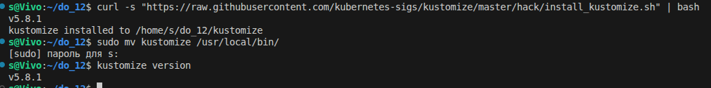
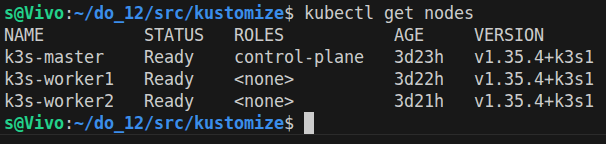

## Part 1. Развертывание приложения с помощью Kustomize


 **Задание**

## 1. Получить набор виртуальных машин с развернутым кластером.


В default  остался   Service kubernetes (это сам API-сервер k8s, его не трогаем) 

Очистил namespace default от приложения DO11, чтобы не конфликтовало с DO12


## 2. Перенести манифесты из предыдущих блоков.


## 3. Установить *kustomize* на локальной машине.


**Скачиваем установщик и переносим в системный PATH (чтобы команда работала из любой папки)**




**kustomize version v5.8.1 - версия установлена**


## 4. Cоздать скелет проекта развертывания с одной базовой конфигурацией (base) и одной оверлейной конфигурацией (production):

```
├── base
│   ├── deployment.yaml
│   ├── kustomization.yaml
│   ├── service.yaml
│   └── ...
├── overlays
│   └── production
│       ├── kustomization.yaml
│       ├── configMap.yaml
│       ├── secret.yaml
│       └── ...
├── kustomization.yaml
└── ...
```


**Структура файлов и деркторий создана**


## 5. Написать базовые и оверлейные конфигурации для kustomize. В базовых указать сервисы и развертывания, в production добавить конкретные секреты и конфигурационные значения.


/home/s/do_12/src/kustomize/base/kustomization.yaml

**Главный файл Kustomize. Он говорит: «вот эти YAML-файлы — части моей базы» (то, что одинаково для всех окружений: dev, staging, production).**

перечислены все 11 манифестов

apiVersion и kind — обязательные «маркеры», что это файл Kustomize. resources — список файлов, которые нужно объединить. Кастомайз их склеит и применит к кластеру всё сразу.


 - apiVersion и kind — обязательные маркеры, что это файл Kustomize
 - resources — список манифестов, которые будут объединены в одну сборку


/home/s/do_12/src/kustomize/overlays/production/kustomization.yaml

Оверлей production: накладывается поверх базовой конфигурации


    Расшифровка:

1) resources — берём всё из ../../base (путь относительный — две точки означают «папка выше», то есть kustomize/, потом base/)
2) Плюс добавляем ConfigMap и Secret из текущей папки
3) patches — список патчей. У нас один — увеличить реплики gateway до 3.


/home/s/do_12/src/kustomize/kustomization.yaml

**корневой kustomization.yaml**


## 6. Создать `replicas-patch.yaml` для оверлей production, который модифицирует количество реплик для деплоймента gateway service до 3 реплик.


/home/s/do_12/src/kustomize/overlays/production/replicas-patch.yaml 

replicas-patch.yaml — патч, увеличивающий gateway до 3 реплик
Это не полный манифест, а только те поля, которые меняем


**Оверлей добавляет ConfigMap, Secret и патч на 3 реплики для gateway.**


**все файлы в /home/s/do_12/src/kustomize/base**


## 7. Собрать результирующий конфигурационный файл, учитывая оверлей `production`.


```
kustomize build overlays/production | head -50
```


```
kustomize build overlays/production | grep -A 3 "name: gateway-service" | head -20
```


вывод kustomize build + grep gateway-service показывает replicas: 3 рядом с name: gateway-service.


Патч применился, gateway-service получит 3 реплики, остальные — по 1. final-manifest.yaml собран (764 строки, 17 КБ). Можно применять.


доказательство пункта 6 методички («модифицирует количество реплик для gateway service до 3 реплик»).


[text](kustomize/final-manifest.yaml)

/home/s/do_12/src/kustomize/final-manifest.yaml


## 8. Запустить функциональные тесты Postman и удостовериться в работоспособности приложения.


**Применяем оверлей production**

Флаг -k — это «kustomize mode» (режим Kustomize) в kubectl. Он сам внутренне выполнит kustomize build и применит результат.


3 пода gateway-service (это и есть патч на 3 реплики) и по одному каждого из остальных. 


gateway-service   3/3 (3 готовых из 3) и 1/1 у всех остальных.


**все результаты 200/201 - УСПЕШНО!**


## Part 2. Развертывание приложения с помощью Helm

**Задание** 


## 1. Получить набор виртуальных машин с развернутым кластером.




**kubectl get nodes**


## 2. Перенести манифесты из предыдущих блоков.


**список манифестов**


## 3. Установить *helm* на локальной машине и удостовериться, что этот инструмент имеет валидное подключение к полученному удаленному кластеру Kubernetes.


**kube-prometheus (Prometheus из DO11 - котрый я делал ещё тогда)**


**Версия Helm - v3.21.0**


## 4. Создать *helm*-чарты и шаблоны для своего приложения с помощью команды `helm create`. Эта команда создаст базовую структуру чарта с шаблонами для ресурсов: deployment, service и ingress.


Задание просит использовать helm create


```
hotels-app/
├── Chart.yaml          ← метаданные
├── values.yaml         ← значения
├── charts/             ← зависимости (нам не нужно)
├── templates/          ← шаблоны манифестов
│   ├── deployment.yaml
│   ├── service.yaml
│   ├── ingress.yaml
│   ├── _helpers.tpl
│   ├── NOTES.txt
│   └── tests/
└── .helmignore
```


Очиcтил дефолтные шаблоны и создал свои
Helm создал шаблон одного приложения. У меня 9 сервисов, поэтому удалил сгенерированное:


копируем манифесты из kustomize/base/


## 5. Отредактировать файл `values.yaml` на диаграмме, чтобы указать параметры конфигурации для твоего приложения, необходимые для создания манифестов Kubernetes для указанных развертываний (deployments). Описать объекты развертывания и сервисов в директории шаблонов (templates).


values.yaml - значения для подстановки в шаблоны.
Меняя эти значения, можно настроить приложение под разные окружения.

- replicaCount.gateway — внутри шаблона доступ через {{ .Values.replicaCount.gateway }}
- image.postgres — через {{ .Values.image.postgres }}
- Иерархия в YAML = иерархия через точку в шаблоне


**cat 12-gateway-service.yaml  ---  видны {{ ... }}.**


## 6. Упаковать *helm*-чарт с помощью команды `helm package` для создания файла `*.tgz`, содержащего чарт и его зависимости.

## 7. Развернуть *helm*-чарт в кластере Kubernetes с помощью команды `helm install`. Указать произвольный `namespace` и `release-name`.

## 8. Проверить статус развернутого приложения при помощи команды `kubectl get`. Результаты представить в отчете.

## 9. Внести как минимум одно изменение в `values.yaml` и выполнить команду `helm upgrade`. 

## 10. Запустить функциональные тесты Postman и удостовериться в работоспособности приложения.
